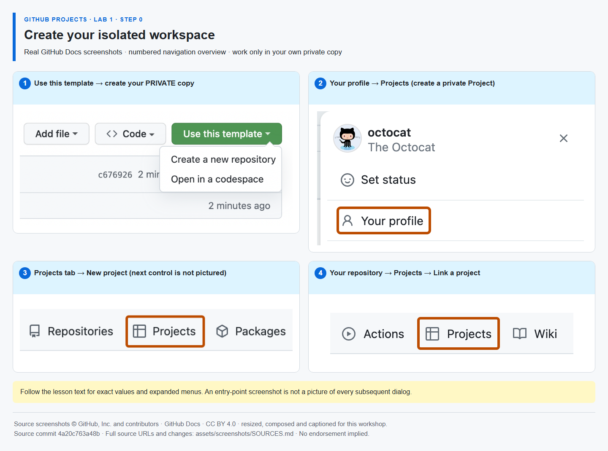

# GitHub Projects — Lab 1: organize your backlog

**One learner. One private repository. One private Project. Three short laboratories.**

Build a fictional digital-service release plan with Mona's GitHub Skills-style guidance. This is the **only starter template**: its private copy contains all three laboratory modules. **Bootstrap creates exactly one issue: Mona's start-here thread.** Every lesson, check and next step stays in that issue's comments. Do not copy the Lab 2 or Lab 3 companion repositories.

## Welcome

- **Who is this for?** Project managers, product owners, Scrum Masters, team leads and developers with basic issue/PR familiarity.
- **What will you learn?** Backlog organization, custom fields, boards, iterations, dependencies, PR traceability, roadmaps, workload views, Insights and status updates.
- **What will you build?** Your own private Project, linked only to your private repository, with synthetic work items and a real documentation PR.
- **How long?** Lab 1: **40 minutes**; Lab 2: **35 minutes**; Lab 3: **35 minutes**. **Four steps per lab**, including Lab 1's Step 0.
- **Prerequisites:** a GitHub account allowed to create private repositories and Projects, enabled GitHub Actions/Issues, Git, VS Code or another text editor, and normal Git authentication. No participant Node/npm, GitHub CLI, PAT, App, instructor provisioning, Copilot, GHAS or cloud account is required.

Use a personal account only if your organization's policy permits. Enterprise Managed User or organization restrictions may prevent private resource creation or Actions; the course cannot bypass them. Private Actions usage may consume the account's included minutes or billed allowance.

## How to start — part of Step 0

1. Select **Use this template → Create a new repository**. Owner: **your account**; name: `my-projects-workshop`; visibility: **Private**. Leave **Include all branches** off. Do not fork this source and do not clone its URL.
2. Open **Issues → Mona's GitHub Projects workshop — start here** in your newly created repository. This is the **only automatically created issue**. Mona welcomes you there, checks each completed step and posts the next instructions as comments in that same thread. Allow a short time for the startup workflow; refresh Issues.
3. If the exercise is missing, open **Actions → Mona — guided workshop → Run workflow → main** once. If Actions or Issues are disabled, enable them for your own copy where permitted, then rerun. The published source intentionally does not seed an exercise.

Mona's Step 0 tells you how to **clone your own copy** and **create/link your private Project**. Cloning by itself does not create either remote resource. The repository and Project must have the same owner. Do not invite other learners.

## Lab 1 — 40 minutes

| Step  | Topic                    | Practical result                                                                            |   Time |
| ----- | ------------------------ | ------------------------------------------------------------------------------------------- | -----: |
| **0** | Create your workspace    | Private template copy, local clone and one linked private Project                           | 12 min |
| **1** | Create your backlog      | Four learner-created work issues plus one converted draft; register their numbers with Mona | 10 min |
| **2** | Add planning information | Priority, Effort and an assigned implementation task                                        | 10 min |
| **3** | Save a delivery board    | Saved Board and a task moved to In progress                                                 |  8 min |

The complete, screenshot-guided activities are in [Step 0](lessons/lab-1/00-workspace.md), [Step 1](lessons/lab-1/01-backlog.md), [Step 2](lessons/lab-1/02-fields.md) and [Step 3](lessons/lab-1/03-board.md). **Follow Mona's comments in your private copy**: they fill in your actual repository and issue numbers. Static lesson files show `{{PLACEHOLDERS}}` intentionally.

## Continue without creating anything else

| Laboratory                                     | Four activities                                                             | Companion reference                                                      |
| ---------------------------------------------- | --------------------------------------------------------------------------- | ------------------------------------------------------------------------ |
| **2 · Plan and complete sprint work · 35 min** | Plan Sprint 1; create a dependency; push/open a linked PR; merge/carry over | [Lab 2](https://github.com/alvine-aurelio-org/bsp-github-projects-lab-2) |
| **3 · Visualize and communicate · 35 min**     | Roadmap; workload; current chart; status update/export                      | [Lab 3](https://github.com/alvine-aurelio-org/bsp-github-projects-lab-3) |

Mona posts Labs 2 and 3 in the **same exercise issue**. The companion repositories are reference guides, not additional learner templates. All work remains in your initial repository and Project.

## How Mona checks work

- **SELF-CONFIRMED:** Project creation/privacy/linking, item membership, fields, views, sprint assignments, charts, updates and export. Use the exact `/project ...` or `/done LAB-STEP` command Mona shows.
- **BACKLOG REGISTRATION:** at Step 1-1, **you** create the work issues, then submit `/backlog #FEATURE #IMPLEMENTATION #VERIFICATION #BUG` in the same Mona thread. Mona verifies their native identities, titles and learner authorship. Their Project membership and draft conversion remain self-confirmed. These are hands-on work items, **not additional instruction issues**.
- **REPOSITORY-VERIFIED:** native issue dependency, PR author/repository/branch, the single changed checklist file, required content, native closing relationship, merge and issue state. Use the exact `/check ...` command Mona shows.
- **MIXED:** Lab 2 completion verifies the merge and issue closure; submitting its check self-confirms Project Done and Sprint 2 carry-over.

`GITHUB_TOKEN` cannot access Projects. This course never asks for an additional token and never calls the Projects API. A submitted Project URL is checked for **syntax and matching owner only**, not existence or access. No screenshot is graded by AI. Mona is a scripted persona, not an AI agent or the `@mona` user account. It never seeds sample work issues or opens new issues for later lessons.

Only the learner who starts the exercise can progress it. Post commands as **new comments in Mona's exercise issue**, not in a PR, work item or public source. No reset, skip, backlog rebinding or `/done` bypass exists for repository checks. `/status` and `/help` are safe at any time. If a command fails, correct the displayed problem and post a fresh command. Do not edit bot comments or course files.

## If something is blocked

- **No Mona:** check the Actions run, Issues setting, private visibility and default branch `main`; rerun the Mona workflow. A public copy is deliberately not initialized. These commands do not configure organization-wide permissions.
- **A check failed:** leave the PR open until Step 2-3 passes. Use the right issue/PR numbers and exact branch/file. Do not commit unrelated files or change the checked PR head after it passes.
- **Git sign-in/author configuration:** use your own normal Git sign-in and repository-local author settings. Do not put credentials in issues, files or command arguments shared with others.
- **Organization requires PR approval:** respect it. The no-instructor path assumes a private personal sandbox that does not require independent review. This lab never teaches self-approval or disabling protections.
- **Feature missing:** do not self-confirm an activity you could not perform. Check account entitlements/policies. The course does not award an API error or missing feature as a pass.
- **An older copy has five bot-created issues:** that was the v1 bootstrap. A template update does not alter existing copies. Start a new private copy from this updated template for the single-issue flow; do not merge v2 over active v1 progress or delete its saved state. The runtime fails closed rather than silently resetting or creating a second instruction thread. No automatic migration or cleanup of learner work is performed.

## Safety and scope

All sample tasks are fictional. No BSP systems, operational data or original proposal documents are included. Keep exports and account screenshots local; do not commit them. No deployments, capacity planning, financial roll-up, mandatory fields, requirements/test management, portfolio dashboard or enforced stage gates are claimed. Advanced governance, audit administration and organization standards remain course discussion topics.

## Author verification

Learners do not run these commands. Authors with Node 22+ can run `npm test` and `npm run verify`; production automation has no installed npm dependencies. [Implementation and evidence](docs/verification.md) describes the verification boundary. Third-party screenshots are actual GitHub Docs navigation captures, annotated and credited in [image sources](assets/screenshots/SOURCES.md). Some overviews show entry points rather than every expanded dialog; captions state this explicitly.

## License and acknowledgements

Workshop text and code: [MIT](LICENSE). Reused GitHub Docs image material: [CC BY 4.0](https://creativecommons.org/licenses/by/4.0/), with source and modification notices in [THIRD-PARTY-NOTICES.md](THIRD-PARTY-NOTICES.md). Octocat artwork and GitHub marks belong to GitHub; [Octodex](https://octodex.github.com/) artwork is linked, not claimed as our own. Inspired by [GitHub Skills](https://github.com/skills/communicate-using-markdown); this independently authored workshop is not an official GitHub Skills course and implies no GitHub or BSP endorsement.
