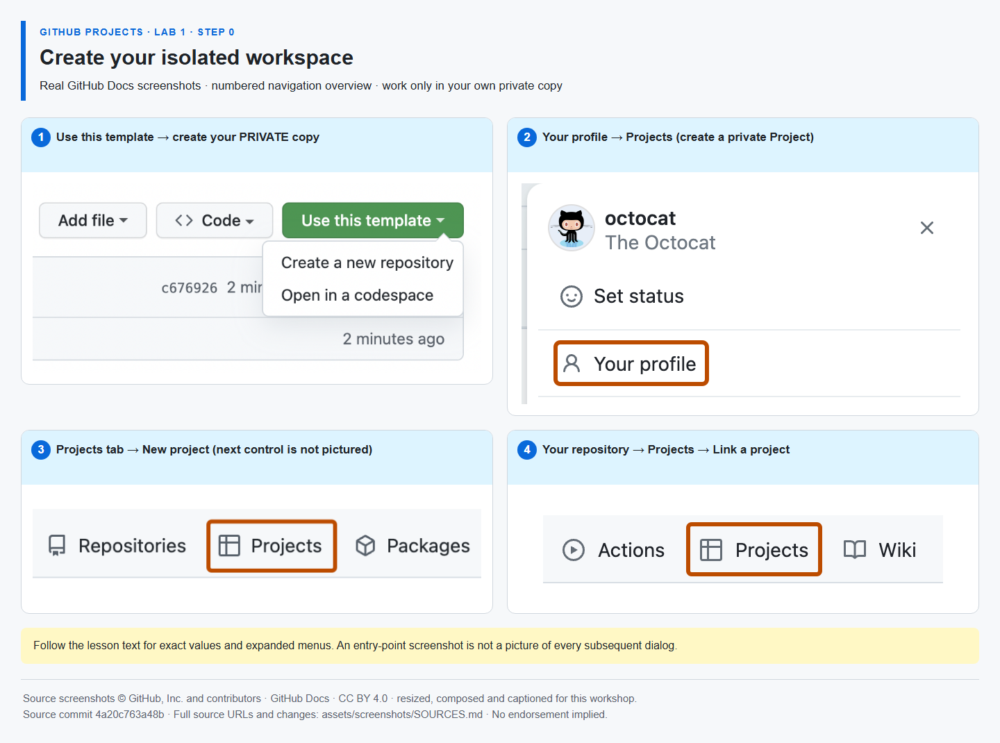

# Step 0 — Create your isolated workspace

**Time: 12 minutes · Topic: repository ownership, cloning and Project creation**

## What and why

Your repository stores instructions, issues and pull requests. Your Project is a separate planning workspace that references those issues. A Git clone downloads files; it does **not** create a remote repository or a Project. You will create both yourself. Keep this same repository and Project for all three labs.

## Do

1. If reading the public guide, choose **Use this template → Create a new repository** on [the Lab 1 starter](https://github.com/alvine-aurelio-org/bsp-github-projects-lab-1/generate). Select **your own account**, name it `my-projects-workshop`, select **Private**, leave **Include all branches** off and create it. If Mona posted this in your private copy, this part is already done: **do not create another repository**.
2. Open **Issues → Mona's GitHub Projects workshop — start here** in your copy. **Mona creates only this one issue.** Every step and its feedback is posted as comments in this same thread after you complete the current step. No sample work issues are created automatically. If the thread has not appeared, open **Actions → Mona — guided workshop → Run workflow → main** once. Actions and Issues must be enabled. Do not fork the template or work in the public source repository.
3. In **your copy**, select **Code → HTTPS → copy URL**. Open a terminal in your preferred local parent folder and clone that URL. In a rendered Mona comment the first command below already points to your copy. In the static guide, replace the placeholders using the URL you just copied.

```powershell
{{CLONE_COMMAND}}
```

Open the newly created local folder in VS Code, then run:

```powershell
git remote -v
```

Both `origin` lines must name **your account and your private copy**, not alvine-aurelio-org/bsp-github-projects-lab-1. Do not change global Git settings. Git authentication may open your normal browser sign-in; never paste credentials into issues.

4. On GitHub, choose **profile picture → Your profile → Projects → New project → Table**. Name it `My digital-service release`. Open the new Project's **… → Settings**, confirm **Private** visibility and do not invite other learners. Return to your repository → **Projects → Link a project** and select it. Both resources must have the **same owner**. If your workshop Project already exists, use that dedicated Project instead of creating a second one.



_The annotated overview uses real GitHub Docs screenshots; numbered captions identify entry points, not unshown dialogs. [Image attribution](https://github.com/alvine-aurelio-org/bsp-github-projects-lab-1/blob/main/assets/screenshots/SOURCES.md)._

## Expected result

- One private repository under your account, with a local clone pointing to it.
- One private Project under the same account, linked from the repository's Projects tab.
- Exactly one automatically created issue exists: Mona's start-here thread. You will create work items yourself when Step 1 asks; those are your backlog, not additional lesson threads.

## Tell Mona

Copy the Project's main URL from the address bar; remove a trailing `/views/...` if present. In **Mona's exercise issue**, post one new comment:

```text
/project https://github.com/users/YOUR-USERNAME/projects/YOUR-PROJECT-NUMBER
```

Use the actual URL and a positive Project number. For an organization-owned copy, use its matching `https://github.com/orgs/OWNER/projects/NUMBER` URL, only if your organization's policy permits private isolated resources.

**SELF-CONFIRMED:** this command attests that you created, linked and made the Project private. Mona checks URL syntax and matching owner only; it cannot inspect your Project with the repository token. Do not provide a PAT, App key or other secret.
