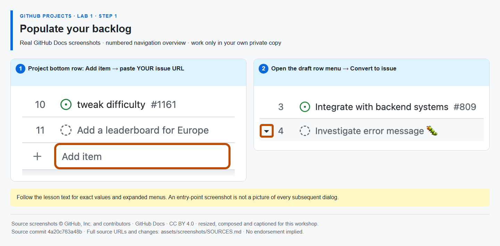

# Step 1 — Populate your backlog

**Time: 10 minutes · Topic: issues, draft ideas and one source of truth**

## What and why

A Project item references a repository issue; it is not a second copy of the task. Draft items capture ideas before they have a repository. Converting a draft gives it an issue number and normal collaboration features.

## Do

1. Open [your Project]({{PROJECT_URL}}). In the bottom **Add item** row, paste each sample issue URL and press Enter:
   - Feature: `https://github.com/{{REPO}}/issues/{{ISSUE_feature}}`
   - Implementation: `https://github.com/{{REPO}}/issues/{{ISSUE_implementation}}`
   - Verification: `https://github.com/{{REPO}}/issues/{{ISSUE_verification}}`
   - Bug: `https://github.com/{{REPO}}/issues/{{ISSUE_bug}}`
2. In **Add item**, type `Prepare the fictional release announcement` and press Enter to create a draft. Open that draft's row menu **… → Convert to issue** and select **your private repository**.
3. Rename the Table view **Backlog** and save changes if shown. Do **not** add Mona's exercise issue to the Project. Keep the four sample issues open.



*The row-menu button is shown; the Convert to issue dialog is described in the text. [Image attribution](https://github.com/alvine-aurelio-org/bsp-github-projects-lab-1/blob/main/assets/screenshots/SOURCES.md).*

## Expected result

Your Backlog contains five real issues: the four samples plus your converted announcement. Each points only to your repository. `Feature`, `Task` and `Bug` in titles describe the scenario; they are **not a claim that organization-wide issue types were configured**.

## Tell Mona

After checking the five rows, post this new comment in Mona's exercise issue:

```text
/done 1-1
```

**SELF-CONFIRMED:** Mona records your confirmation; it does not inspect Project membership or the converted draft.
