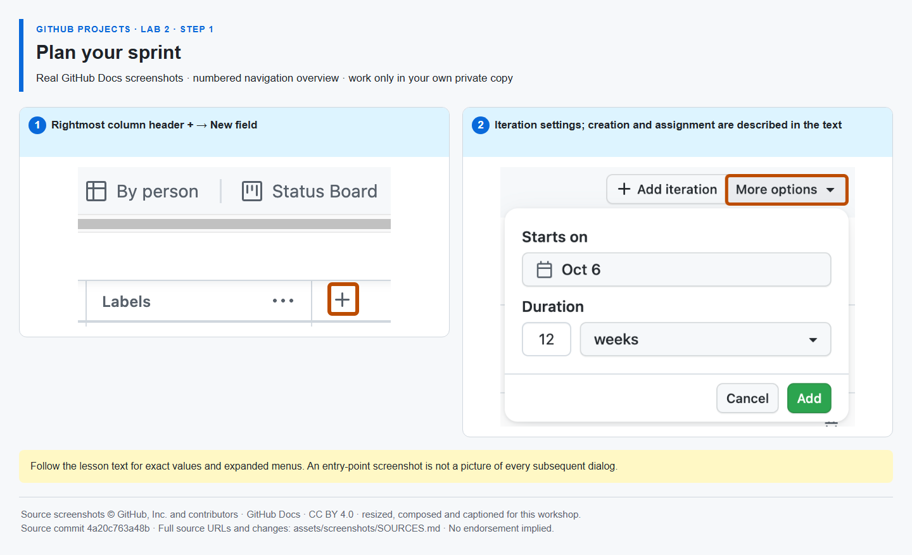

# Step 1 — Plan your sprint

**Time: 8 minutes · Topic: iterations and sprint commitment**

## What and why

An iteration field assigns work to a timebox. It is different from a repository milestone, which groups a release. Planning work in an iteration makes the team's short-term commitment visible without copying issues into a second board.

## Do

1. Open [the same Project]({{PROJECT_URL}}) → Backlog. Use **+ → New field**, name **Sprint**, type **Iteration**. Start the first iteration this week and use a one-week duration.
2. In Project **… → Settings → Sprint**, rename the first two iterations **Sprint 1** and **Sprint 2**, keeping different consecutive start dates. Create the second iteration if necessary. Return to Backlog.
3. Set implementation #{{ISSUE_implementation}} and verification #{{ISSUE_verification}} to **Sprint 1**. In the view settings, group by **Sprint** and choose the **Effort** field sum. Save the view. Their combined effort is **5**, not a measure of available working hours.



*The iteration-settings screenshot shows the settings area; follow the text for initial field creation and naming. [Image attribution](https://github.com/alvine-aurelio-org/bsp-github-projects-lab-1/blob/main/assets/screenshots/SOURCES.md).*

## Expected result

Two distinct iterations exist. Sprint 1 contains the two delivery tasks with total Effort 5.

## Tell Mona

```text
/done 2-1
```

**SELF-CONFIRMED:** iteration setup and Project totals are not API-verified.
