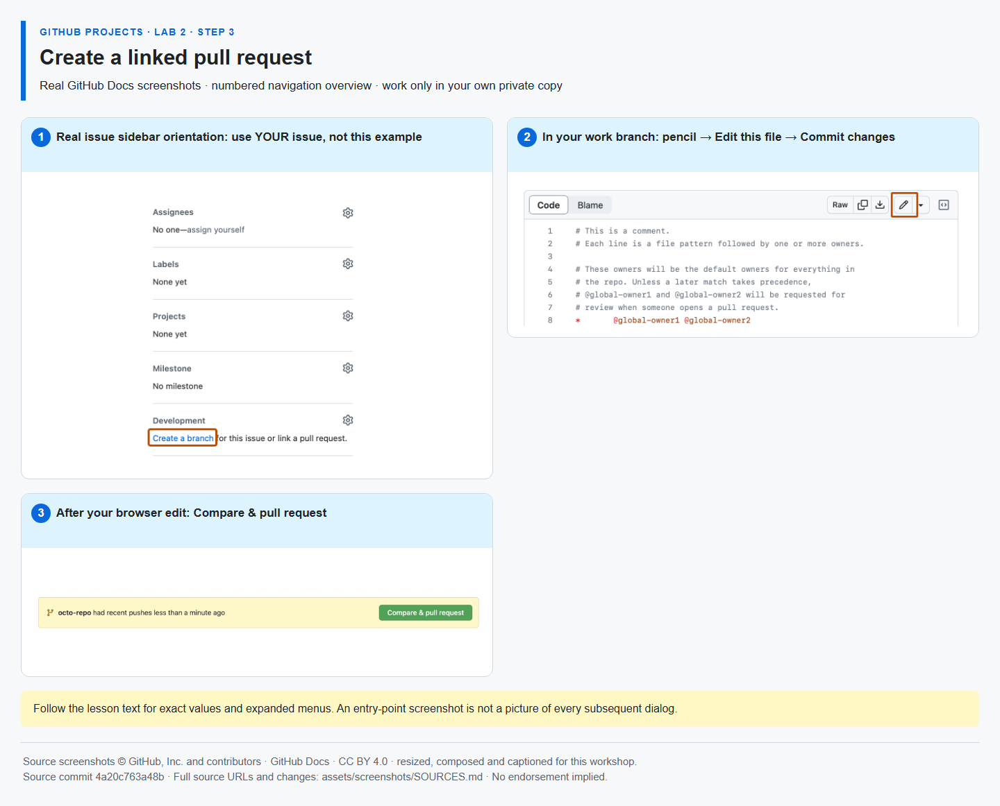

# Step 3 — Create a linked pull request

**Time: 12 minutes · Topic: browser editing, branches and linked pull requests**

## What and why

A branch isolates a proposed change; a PR lets you inspect it before merging. A closing reference links the change to the planned issue. This exercise changes **one file only**. Never edit workflows, lesson files or Mona's saved progress.

## Do

1. Open [your repository's Code tab](https://github.com/{{REPO}}). Select the branch menu showing **main**, type **workshop/release-checklist** and choose **Create branch: workshop/release-checklist from main**. Confirm that branch name appears in the menu before editing.
2. Open **work → release-checklist.md** and click the **pencil / Edit this file** button. Change only the first task to:

```markdown
- [x] Publish the service release checklist
```

Leave the second checkbox unchecked. Click **Commit changes…**, use message **Publish the service release checklist**, choose **Commit directly to the workshop/release-checklist branch** and confirm. Do not commit to main or edit any other file.

3. Open your repository on GitHub → **Compare & pull request**. Base: **main**; compare: **workshop/release-checklist**. Use title **Publish the service release checklist** and put this line in the description:

```text
Closes #{{ISSUE_implementation}}
```

    Create the PR, confirm its **Development** relationship points to implementation, and leave it **open**. Do not merge until Mona posts Step 4. All actions in this step take place on the GitHub website.



_Use the browser's branch menu and pencil button to make the change, then open the PR. [Image attribution](https://github.com/alvine-aurelio-org/bsp-github-projects-lab-1/blob/main/assets/screenshots/SOURCES.md)._

## Ask Mona to check

In Mona's exercise issue, replace the placeholder with your actual PR number:

```text
/check 2-3 #YOUR_PR_NUMBER
```

**REPOSITORY-VERIFIED:** Mona checks author, same-repository head/base, exact branch, the native closing relationship, the only changed file and the required checked line. Never submit the sample issue number in place of the PR number. Do not change the PR's head after this passes.
