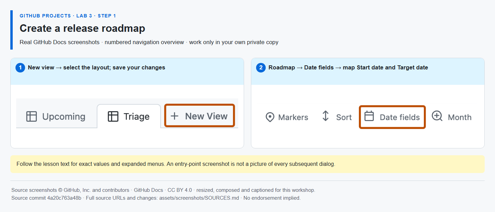

# Step 1 — Create a release roadmap

**Time: 10 minutes · Topic: date fields and roadmap planning**

## What and why

A Roadmap places the same work on a timeline using date or iteration fields. It makes timing and overlap easier to discuss. It is not a cross-Project portfolio roll-up or an automatic scheduling engine.

## Do

1. Open [your same Project]({{PROJECT_URL}}) → Backlog. Create **Start date** and **Target date**, both type **Date**, using the header **+ → New field**. Reuse an existing correctly typed field rather than duplicating it.
2. Give implementation #{{ISSUE_implementation}} dates within Sprint 1 and verification #{{ISSUE_verification}} dates within Sprint 2. Ensure each start is on or before its target.
3. Click **New view → Roadmap**, name it **Release roadmap**. Select **Date fields** and map Start date and Target date to the fields you just populated. Under **Markers**, show the Sprint iteration markers. Save the view.



*The screenshot highlights where to enter date mapping; it does not show your own dates. [Image attribution](https://github.com/alvine-aurelio-org/bsp-github-projects-lab-1/blob/main/assets/screenshots/SOURCES.md).*

## Expected result

Two timeline bars appear: completed implementation in Sprint 1 and planned verification in Sprint 2. If a bar is absent, check that its date cells are populated and its view filter does not hide it.

## Tell Mona

```text
/done 3-1
```

**SELF-CONFIRMED:** roadmap settings, dates and markers are not API-verified.
