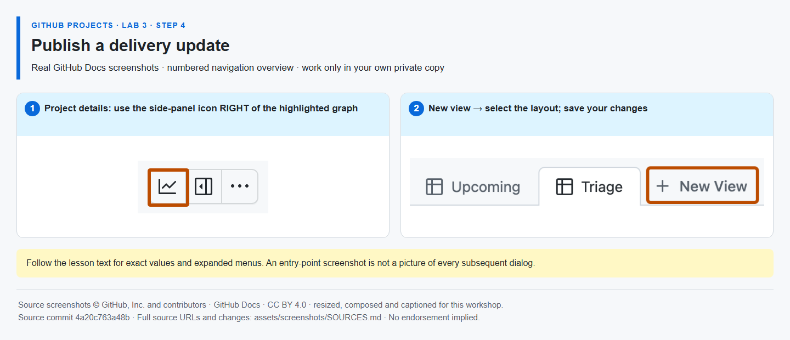

# Step 4 — Publish a delivery update

**Time: 10 minutes · Topic: project health, mitigation and a reporting snapshot**

## What and why

A status update explains the delivery situation behind the counts. Its target date describes project delivery, not the due date of every task. An exported view is a point-in-time snapshot; the Project remains the source of truth.

## Do

1. Open the Project's top-right **Project details** side panel. Under **Status updates**, choose **Add update**. Select **At risk**, set a target date after Sprint 2 and write:

   > **Risk:** checklist verification is unfinished.<br>
   > **Mitigation:** the verification task has an owner and is planned for Sprint 2.<br>
   > **Next action:** verify the published checklist before the target date.

   Select **Save update**. This describes fictional delivery risk, not a real BSP service.

2. Return to **Backlog**, clear filters and ensure Title, Status, Assignees, Priority, Effort and Sprint are visible. Open **View** settings → **Export view data**. Confirm the TSV download appears in your browser's Downloads list. No spreadsheet or text editor is needed.
3. Check that the unfiltered Backlog shows your five work items and that the update is visible in the Project. Keep the download private; do not attach it or personal screenshots to an issue. Close no unfinished task merely to make the chart look complete.



_This overview provides navigation context; Add update and Export view data are described in the text rather than shown in an invented dialog. [Image attribution](https://github.com/alvine-aurelio-org/bsp-github-projects-lab-1/blob/main/assets/screenshots/SOURCES.md)._

## Expected result

A saved At risk update with mitigation and target date; a TSV download produced from the unfiltered saved view; the same one repository and one Project you created at the start.

## Finish with Mona

```text
/done 3-4
```

**SELF-CONFIRMED:** status update and export are not inspected by Mona. Mona then posts a recap distinguishing verified repository work from self-confirmed Project work and closes only the exercise issue. Keep verification open for Sprint 2.
